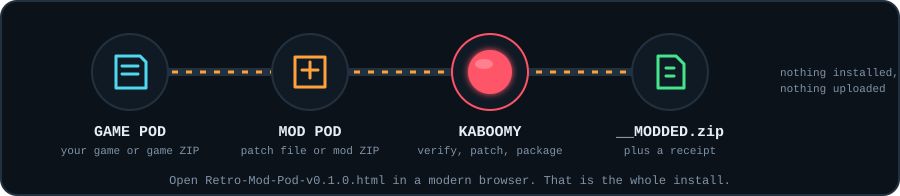
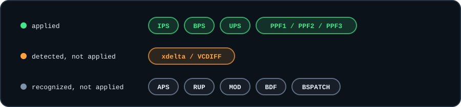
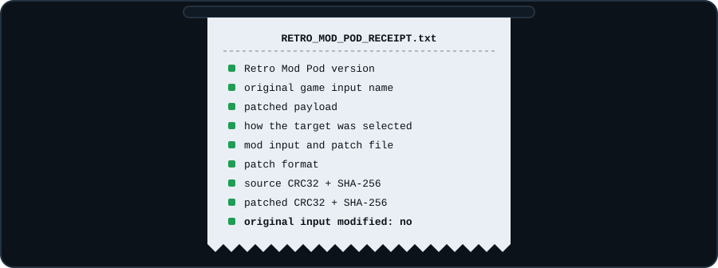

# Retro Mod Pod

**Feed it a game. Feed it a mod. Press the irresponsible button.**

Retro Mod Pod is a single-file, local browser tool for applying supported retro-game patches without making the user learn the patching ritual first.

Give the **GAME POD** your own game file or game ZIP. Give the **MOD POD** a patch file or mod ZIP. Press **KABOOMY**.

The original input stays untouched. Retro Mod Pod creates a new `__MODDED.zip` and includes a patch receipt showing what it did.

Created by Wakka through directing, testing, and iterating with AI.

**Current release:** v0.1.0  
**Operation:** local / offline  
**License:** MIT

 

I made Retro Mod Pod because I didn't know how ROM patching worked.

I kept running into patch formats, base-game revisions, checksums, different patchers, and instructions that assumed I already knew which file mattered and what tool I was supposed to use.

I wasn't trying to become a ROM-patching expert. I knew what I wanted:

**game in one side → mod in the other → KABOOMY → patched game out**

So I made the knowledge part the tool's problem.

Retro Mod Pod tries to identify the patch, identify the correct game payload, verify what it can, apply the patch locally, preserve the original, and package the result. If the situation is ambiguous or the base game does not match what the patch expects, it refuses to guess.

That refusal is part of the design.

 

1. Download `Retro-Mod-Pod-v0.1.0.html` from Releases.
2. Open it in a modern browser.
3. Put your own game file or game ZIP into **GAME POD**.
4. Put your patch file or mod ZIP into **MOD POD**.
5. Press **KABOOMY**.
6. If verification succeeds, Retro Mod Pod downloads a new `__MODDED.zip`.

Nothing needs to be installed and Retro Mod Pod does not upload your game or patch files.

 

| Capability | Status |
| --- | --- |
| IPS patching | ✅ Supported |
| BPS patching | ✅ Supported |
| UPS patching | ✅ Supported |
| PPF1 / PPF2 / PPF3 patching | ✅ Supported |
| xdelta / VCDIFF | 🟡 Detected, not applied yet |
| APS / RUP / MOD / BDF / BSPATCH | ⚪ Recognized, not applied yet |
| ZIP game packages | ✅ Supported |
| Raw game / ROM / disc-image input | ✅ Supported |
| BPS / UPS source revision checking | ✅ Source size + CRC32 |
| BPS / UPS patch and output validation | ✅ CRC32 checked |
| PPF2 / PPF3 validation data | ✅ Used when present |
| CUE/BIN targeting | ✅ Uses the BINARY image referenced by a single CUE sheet |
| Ambiguous multi-patch packages | ⛔ Refused |
| Ambiguous game targets | ⛔ Refused |
| Original input modification | 🔒 Never |
| Patch receipt | ✅ Included in every successful output |

Common game-image extensions recognized by the v0.1.0 target selector include:

`bin`, `iso`, `img`, `gba`, `gb`, `gbc`, `sfc`, `smc`, `nes`, `n64`, `z64`, `v64`, `nds`, `md`, `gen`, `32x`, `pce`, `rom`, and `chd`.

 

Retro Mod Pod intentionally stops instead of improvising when it cannot establish a safe target.

Examples include:

- the mod package contains more than one patch
- the game package contains multiple plausible targets
- a BPS or UPS patch expects a different source CRC32
- a PPF validation block does not match
- the patch format is recognized but not implemented in v0.1.0

One of the first real-world tests used the Pokémon Unbound patch. A FireRed file had the expected size but the wrong CRC32, so Retro Mod Pod returned **NO KABOOMY** instead of producing a questionable patched ROM.

That is exactly the behavior I wanted.

 

Every successful output contains:

`RETRO_MOD_POD_RECEIPT.txt`

The receipt records:

- Retro Mod Pod version
- original game input name
- patched payload
- how the target was selected
- mod input and patch file
- patch format
- source CRC32 and SHA-256
- patched CRC32 and SHA-256
- confirmation that the original input was not modified

 

Retro Mod Pod v0.1.0 is one HTML file containing its interface and patch engine.

It does not download games, ROMs, BIOS files, patches, or mods. It does not upload your inputs to a server.

Use files you are legally permitted to use. Retro Mod Pod itself contains no commercial game data or third-party patches.

 

v0.1.0 is deliberately conservative.

- xdelta / VCDIFF is detected but not applied.
- Other recognized formats such as APS and RUP are not implemented yet.
- A mod package containing multiple patch files is rejected rather than having the tool invent an order.
- When a patch format does not provide strong source-validation data, target selection necessarily falls back to CUE/package structure and recognized game-image candidates.

 

- `Retro-Mod-Pod-v0.1.0.html` — the complete v0.1.0 tool
- `README.md` — project overview and usage
- `LICENSE` — MIT license
- `RELEASE_NOTES_v0.1.0.md` — first public release notes
- `GITHUB_SETUP.txt` — repository About text, topics, and release metadata

 

Retro Mod Pod's original code is released under the MIT License.

Game names, patches, ROMs, disc images, and other third-party material remain the property of their respective owners. Retro Mod Pod is an independent utility and is not affiliated with game publishers, console manufacturers, ROM-hack authors, or patch-format creators.

